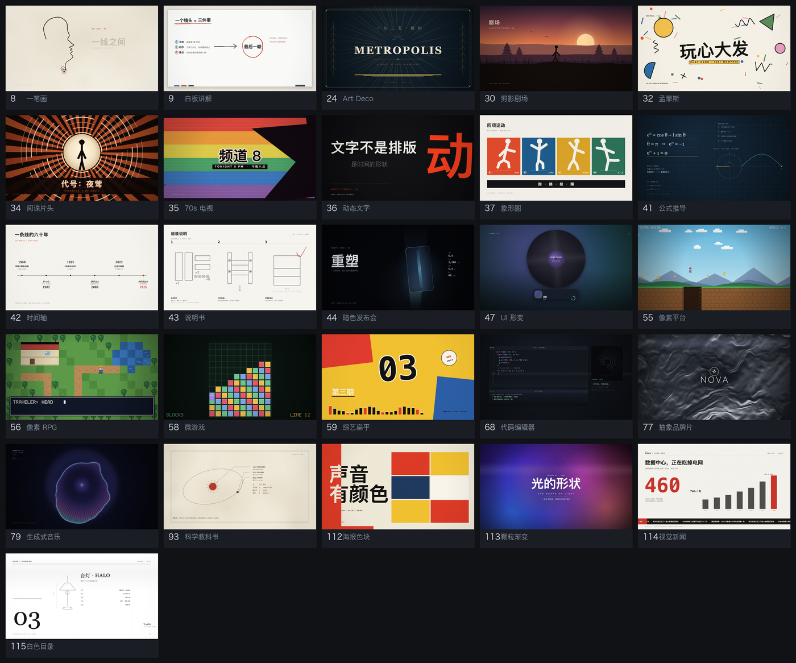

# 纯代码视频风格库 · 34 种配方

把"某种视觉风格"翻译成**可直接执行的渲染规格**，用代码出片。不调用任何图像 / 视频生成模型，不依赖实拍素材。



每条风格都出两个画幅：1920×1080 与 1080×1920。竖屏是重新排版，不是裁切。
同一时间点重渲两次，像素完全一致——片子可以随时返修、逐帧重出。

---

## 为什么是"配方"而不是"提示词"

通用的视频风格描述是写给画师和生成模型看的：

> 中国水墨写意风格：暖色宣纸、墨分五色、飞白笔触……

把这句话丢给一个只会写代码的模型，它只能猜。同一句话翻成规格才可执行：

> 宣纸底 `#F2EEE5` + 三层噪点；墨色 `#14120F`，浓淡五档按 `t` 插值；笔锋宽度沿路径从 34px 收到 6px，末段 12% 路径随机断开形成飞白……

**差别是决定性的**：同一个风格，只给形容词大约 5 分，给足坐标、色值、时间轴能到 8 分以上。
所以这里每份配方都带四样东西：横向与竖向两套版面参数、一条写满 6 秒的时间轴、踩过的坑、一段可整段复制的规格卡。

---

## 安装

### 当 Skill 用

```bash
git clone https://github.com/Chans-gh/deepseek-video-styles.git \
  ~/.workbuddy/skills/deepseek-video-styles
```

目录名必须叫 `deepseek-video-styles`（与 `SKILL.md` 里的 `name` 一致）。重开一个会话，
说"用 47 号 UI 形变做个 6 秒片"这类请求就会被自动接住。Claude Code 用户放到 `~/.claude/skills/` 同理。

### 只当代码库用

```bash
git clone https://github.com/Chans-gh/deepseek-video-styles.git
cd deepseek-video-styles
bash scripts/setup.sh          # 装 puppeteer-core + 内置 ffmpeg 静态包
```

---

## 快速开始

```bash
# 先出三张静帧（约 2 秒）
node scripts/render.mjs --scene assets/scenes/_starter-canvas.html \
  --out out/try --aspect 16:9 --stills 1,3,5 --stills-only

# 再出整片（6 秒 × 24fps = 144 帧，约 20 秒）
node scripts/render.mjs --scene assets/scenes/_starter-canvas.html --out out/try --aspect 16:9
node scripts/render.mjs --scene assets/scenes/_starter-canvas.html --out out/try-9x16 --aspect 9:16
```

三个起手模板，复制改名就能开工：

| 模板 | 适合 | 画法 |
|---|---|---|
| `_starter-canvas.html` | 大多数：排版、几何、图表 | Canvas 2D 直接绘制 |
| `_starter-pixel.html` | 像素风、游戏片头 | 低分辨率离屏 + 整数放大 |
| `_starter-gl.html` | 发光、噪声、流体 | WebGL2 着色器 + 2D 字层 |

---

## 34 种风格

<details>
<summary>展开全部（编号 · 风格 · 适合什么）</summary>

| # | 风格 | 适合 |
|---|---|---|
| 8 | [一笔画](references/styles/08-oneline.md) | 开场、收尾、人生故事 |
| 9 | [白板讲解](references/styles/09-whiteboard.md) | 科普、"怎么运作" |
| 21 | [蓝图 / 工程制图](references/styles/21-blueprint.md) | 产品原理、结构拆解 |
| 24 | [装饰艺术（Art Deco）](references/styles/24-deco.md) | 高端品牌、酒店、爵士题材 |
| 30 | [剪影剧场](references/styles/30-silhouette.md) | 诗意短片 |
| 31 | [包豪斯](references/styles/31-bauhaus.md) | 原则、步骤、强信息 |
| 32 | [孟菲斯](references/styles/32-memphis.md) | 轻松公告、短视频 |
| 33 | [瑞士国际主义排版](references/styles/33-swiss.md) | 设计、规则类内容 |
| 34 | [60 年代间谍片头](references/styles/34-spy.md) | 片头、预告 |
| 35 | [70 年代电视片头](references/styles/35-tv70.md) | 怀旧开场、系列片头 |
| 36 | [动态文字排版](references/styles/36-kinetic.md) | 金句、短视频钩子、作品集 |
| 37 | [象形图运动图形](references/styles/37-pictogram.md) | 赛事、分类介绍 |
| 40 | [数据叙事](references/styles/40-data.md) | 用数字说话、前后对比 |
| 41 | [公式推导讲解](references/styles/41-derivation.md) | 数学、AI 原理 |
| 42 | [极简图解 / 时间轴](references/styles/42-timeline.md) | 历史、行业史、技术科普 |
| 43 | [说明书 / 步骤图](references/styles/43-manual.md) | 教程、菜谱、组装 |
| 44 | [暗色科技发布会](references/styles/44-keynote.md) | 软件发布 |
| 47 | [UI 形变循环](references/styles/47-ui-morph.md) | 产品动效、作品集 |
| 55 | [16-bit 像素平台](references/styles/55-platformer.md) | 游戏化、进度 |
| 56 | [16-bit 像素 RPG](references/styles/56-rpg.md) | 冒险故事 |
| 58 | [微游戏快闪](references/styles/58-microgame.md) | 趣味、短视频 |
| 59 | [综艺节奏扁平](references/styles/59-variety.md) | 节奏综艺、年度回顾 |
| 63 | [1920 年代默片](references/styles/63-silent.md) | 喜剧 |
| 66 | [终端 / ASCII CRT](references/styles/66-crt.md) | AI / 技术过程 |
| 67 | [科幻 HUD 界面](references/styles/67-hud.md) | 分析、评分 |
| 68 | [代码编辑器叙事](references/styles/68-code.md) | 开发者故事 |
| 77 | [抽象品牌片](references/styles/77-brand.md) | 品牌形象片 |
| 79 | [生成式抽象 / 音乐可视化](references/styles/79-generative.md) | 音乐片、艺术装置 |
| 92 | [玻璃拟态极光](references/styles/92-glass.md) | 消费类 App、氛围感首屏 |
| 93 | [1950 年代科学教科书](references/styles/93-textbook.md) | 科普、复古教学栏目 |
| 112 | [海报色块动态字](references/styles/112-poster-blocks.md) | 音乐节、活动预告、品牌宣言 |
| 113 | [颗粒渐变开场](references/styles/113-grain-gradient.md) | 科技产品发布的开场 |
| 114 | [视觉新闻解说](references/styles/114-news.md) | 新闻与时事、数据故事 |
| 115 | [白色目录册](references/styles/115-catalog.md) | 产品介绍、电商与新品发布 |

</details>

按用途找（片头 / 科普 / 数据 / 游戏 / 情感…）见 [`references/styles.md`](references/styles.md)。

---

## 一份配方长什么样

以 47 号 UI 形变循环为例，去掉正文后骨架是这样：

```markdown
# 47 UI 形变循环 · UI Morph

**技术栈** Canvas 2D（卡 → 播放器 → 胶囊三态插值 + 黑胶收尾）
**画幅** 16:9（1920×1080）+ 9:16（1080×1920）

| 参数 | 16:9 | 9:16 |
|---|---|---|
| 卡 | 760,250 / 400×400 r34 | 240,700 / 600×600 r44 |
| 播放器面板 | 460,240 / 1000×400 r40 | 80,460 / 920×760 |
| 胶囊 | 700,880 / 520×92 r46 | 120,1580 / 840×110 |

**时间轴**：0–1.1 卡片 → 1.1–2.1 展开为播放器（mixRect 插值）
→ 3.7–4.7 收起为胶囊，同时黑胶与封面场压上来 → 4.7–6 胶囊态停留

**注意事项** / **规格卡**（省略）
```

坐标、字号、圆角都是实数，直接抄进场景的 `aspects` 就行，不用估。

---

## 两条硬验收

| 验收 | 判据 | 怎么跑 |
|---|---|---|
| **确定性** | 同一 `t` 渲两次，PNG 逐字节相同 | `bash scripts/check-determinism.sh scenes/my.html` |
| **动态帧** | 144 帧里 ≥60% 有整帧级变化 | `ffmpeg -i out.mp4 -vf "select=gt(scene\,0.0001),metadata=print" -f null -` |

盯这两条的原因很实际：不拧确定性，片子每次渲都不一样，没法返修；不拧动态帧，前半段有内容、后半段是死画面，
配乐一放就露馅。检测口径是**整帧面积差**——几十像素的文字闪烁在直方图上等于没动。

---

## 目录结构

```text
.
├── SKILL.md                  Agent 入口：五步工作流、六条硬规矩、症状对照表
├── references/
│   ├── styles.md             34 种目录 + 按用途找
│   ├── styles/               34 份配方，一份一条
│   ├── prompt-spec.md        把风格描述翻成规格（六段式 / 参数翻译 / 黑名单）
│   ├── tech-matrix.md        技术选型、运行环境、已知限制
│   ├── acceptance.md         验收口径与失败归因
│   └── recipe-format.md      自己写新配方的字段规范
├── assets/
│   ├── lib/                  8 件公共件：core / type / post / anim / draw / pixel / ui / gl
│   ├── scenes/               3 个起手模板
│   ├── examples/             42 时间轴 · 55 像素平台 · 77 品牌片（完整源码）
│   └── preview/              README 用的总览图
└── scripts/
    ├── render.mjs            确定性渲染器：seek(t) → 逐帧 PNG → mp4
    ├── setup.sh              装依赖
    ├── check-determinism.sh  确定性校验
    └── tools/                sheet.py 联系表 · gallery.py 总览图
```

---

## 环境要求

- **Node 20+**、**Python 3.10+**
- **Chrome**：由 `puppeteer-core`（≥25）拉起，无需单独装
- **ffmpeg**：`setup.sh` 装 npm 静态包，不依赖系统 ffmpeg
- macOS / Linux 可直接用；Windows 需要 WSL（脚本是 bash）

---

## 已知限制

- **笔触型风格不做**：水墨、水彩、油画、素描、点刻。程序近似笔触，越改越像贴图——这是能力边界，不是待办。
- **依赖实拍的风格不做**：真人、口播、混剪、2.5D 视差。
- **中文字体用系统自带**：跨机器字宽会漂零点几像素，关键文字需逐字定点、宽度取整（配方里已注明）。
- **渲染器无并发**：144 帧约 19 秒，60 秒长片会到分钟级；长片建议分片渲染。
- **9:16 满幅设计**：若发布到抖音 / 视频号，底部约 250px 会被平台 UI 压住，重要信息别放最底。

---

## 许可

- 代码（`scripts/`、`assets/lib/`）：**MIT**
- 文档与配方（`references/`、`README.md`）：**CC BY 4.0**

详见 [`LICENSE`](LICENSE) 与 [`LICENSE-DOCS`](LICENSE-DOCS)。
